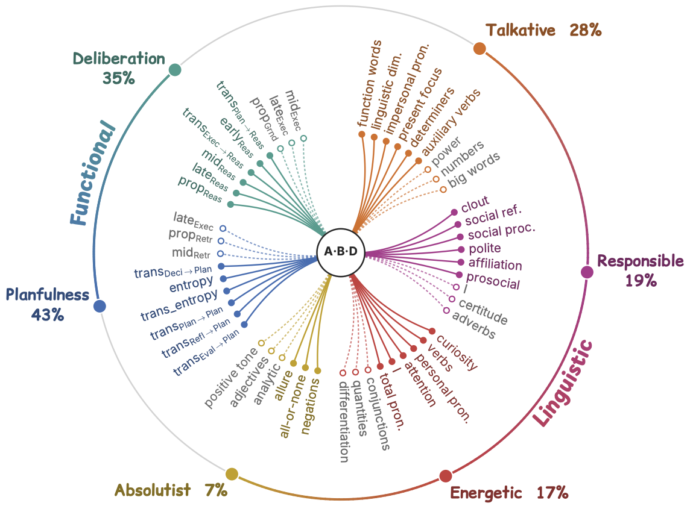
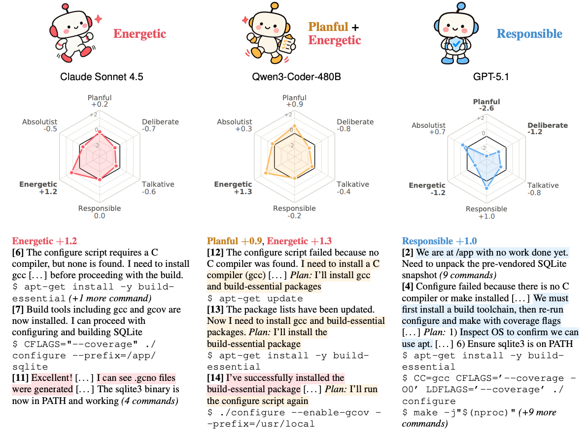

# A-B-D: On the Behavioral Traits of LLM Agents

Code for the paper 
([**On the Behavioral Traits of LLM Agents**](https://arxiv.org/abs/2609.32776)).

<p align="center">


</p>

We annotate a large-scale collection of agent trajectories in the wild for **functional**
and **linguistic** behaviors. We then adapt trait analysis methods from psychology to
identify trait behaviors and perform factor analysis to derive a low-dimensional,
model-attributable behavioral structure.

The codebase is organized as:
| directory | contents |
|---|---|
|`behavior-annotation/`|annotate functional behaviors for the trajectories|
|`liwc-traits/`|prepare and process trajectories for linguistic behaviors|
|`trait-tests/`|filter and identify the trait behaviors|
|`factor-analysis/`|derive a low-dimensional, model-attributable behavioral structure|

## Setup

```bash
git clone https://github.com/JoeZhao527/A-B-D.git && cd A-B-D
pip install -r requirements.txt          # numpy, pandas, pyarrow, scipy, statsmodels, requests, huggingface_hub
pip install vllm                         # only needed to run the annotator yourself (step 1.2)
```

Tested with Python 3.13, numpy 2.5, pandas 3.0, pyarrow 25, scipy 1.18, statsmodels 0.14.

## Data

All data is on the Hugging Face Hub. All commands in this README are run from the
repository root.

| dataset | contents |
|---|---|
| [`A-B-D/wild-trajectory`](https://huggingface.co/datasets/A-B-D/wild-trajectory) | 27,803 trajectories, one Harbor ATIF-v1.8 document per row |
| [`A-B-D/wild-trajectory-annotations`](https://huggingface.co/datasets/A-B-D/wild-trajectory-annotations) | segmented agent steps and their Act·ONOMY span annotations (outputs of steps 1.1–1.3) |
| [`A-B-D/wild-trajectory-liwc`](https://huggingface.co/datasets/A-B-D/wild-trajectory-liwc) | cleaned agent prose, its metadata, and the LIWC-22 output (outputs of steps 2.1–2.2) |

```bash
hf download A-B-D/wild-trajectory             --repo-type dataset --local-dir data/wild-trajectory
hf download A-B-D/wild-trajectory-annotations --repo-type dataset --local-dir data/annotations
hf download A-B-D/wild-trajectory-liwc        --repo-type dataset --local-dir data/liwc
```

```
data/
├── wild-trajectory/
│   └── data/train-*.parquet       # trajectories
├── annotations/
│   ├── turns.parquet              # released output of step 1.1
│   └── annotations.jsonl          # released output of step 1.3
└── liwc/
    ├── trajectories_for_liwc.csv  # released output of step 2.1
    ├── traj_meta.csv              # released output of step 2.1
    └── liwc_raw_output.csv        # released output of step 2.2
```

The trajectory readers (`turn_segment.py`, `export_prose_for_liwc.py`) go through
[`atif_io.py`](atif_io.py), which turns each row back into its ATIF document.

Every stage writes its results to `<stage>/out/`. The paper's results from step 3.1 on
are committed in `trait-tests/out/` and `factor-analysis/out/`, except the adjusted
feature tables of step 3.1, which are large. Those and the feature tables of steps 1.4
and 2.3 are rebuilt from the released data in a few minutes.

---

## 1. Functional behavior annotation — `behavior-annotation/`

Each annotatable agent step (one model call that carries reasoning, a message or a tool
call) is shown to an LLM annotator together with the preceding *K* = 8 steps. The
annotator picks up to three verbatim quotes from the step and codes each with an Act·ONOMY
action group and sub-action (`codebook/act-onomy_taxonomy.csv`). The span labels are then turned into 211
per-trajectory features in four blocks: A frequency, B within-step co-occurrence,
C step-to-step transition, D stage (position in the trajectory).

<details>
<summary><b>Step 1.1 — Segment trajectories into agent steps</b></summary>

> **Released data:** skip this step and set
> `TURNS=data/annotations/turns.parquet`.

```bash
TURNS=behavior-annotation/data/turns.parquet
python behavior-annotation/src/turn_segment.py --hf-dir data/wild-trajectory --out $TURNS
```

<table>
<tr><th align="left">path / variable</th><th align="left">description</th></tr>
<tr><td colspan="2" align="left"><em>Input</em></td></tr>
<tr><td><code>data/wild-trajectory/</code></td><td>the trajectories, one ATIF document per row</td></tr>
<tr><td colspan="2" align="left"><em>Output</em></td></tr>
<tr><td><code>$TURNS</code></td><td>one row per annotatable agent step: the step text shown to the annotator, the context it received, and the trajectory's model, harness and task type</td></tr>
</table>

</details>

<details>
<summary><b>Step 1.2 — Annotate the steps with an LLM</b></summary>

> **Released data:** skip this step and step 1.3, and set
> `ANNOTATIONS=data/annotations/annotations.jsonl`.

The annotator is gpt-oss-120b served by vLLM (one GPU with ≥ 80 GB). The steps are
shuffled with a fixed seed and split into `--num-chunks` shards, so the shards can run
on separate GPU nodes. A shard that is restarted resumes where it stopped. The paper used
36 shards.

```bash
vllm serve openai/gpt-oss-120b --port 8000 --gpu-memory-utilization 0.92 &

for k in $(seq 0 35); do
  python behavior-annotation/src/batch_annotate.py --turns $TURNS \
      --num-chunks 36 --chunk-id $k --level sub --k 8 --workers 32 \
      --base-url http://localhost:8000/v1 --model openai/gpt-oss-120b \
      --out-dir behavior-annotation/data/batch
done
```

<table>
<tr><th align="left">path / variable</th><th align="left">description</th></tr>
<tr><td colspan="2" align="left"><em>Input</em></td></tr>
<tr><td><code>$TURNS</code></td><td>the agent steps from step 1.1</td></tr>
<tr><td><code>behavior-annotation/codebook/act-onomy_taxonomy.csv</code></td><td>the Act·ONOMY taxonomy given to the annotator</td></tr>
<tr><td colspan="2" align="left"><em>Output</em></td></tr>
<tr><td><code>behavior-annotation/data/batch/annotations_chunk_&lt;k&gt;.jsonl</code></td><td>one record per step of shard <em>k</em>: its labelled spans (quote, action group, sub-action)</td></tr>
</table>

</details>

<details>
<summary><b>Step 1.3 — Merge the shards</b></summary>

The merge also checks that every step in `$TURNS` was annotated and reports the missing
ones.

```bash
ANNOTATIONS=behavior-annotation/data/annotations_all.jsonl
python behavior-annotation/src/batch_collect.py \
    --in-dir behavior-annotation/data/batch --turns $TURNS --out $ANNOTATIONS
```

<table>
<tr><th align="left">path / variable</th><th align="left">description</th></tr>
<tr><td colspan="2" align="left"><em>Input</em></td></tr>
<tr><td><code>behavior-annotation/data/batch/</code></td><td>the annotation shards from step 1.2</td></tr>
<tr><td><code>$TURNS</code></td><td>the agent steps from step 1.1, to check coverage</td></tr>
<tr><td colspan="2" align="left"><em>Output</em></td></tr>
<tr><td><code>$ANNOTATIONS</code></td><td>all annotated steps in one file, one record per step</td></tr>
</table>

</details>

<details>
<summary><b>Step 1.4 — Extract the functional features</b></summary>

```bash
python behavior-annotation/features/extract_features.py \
    --annotations $ANNOTATIONS --turns $TURNS --unit group \
    --out behavior-annotation/out/features_group.csv
```

<table>
<tr><th align="left">path / variable</th><th align="left">description</th></tr>
<tr><td colspan="2" align="left"><em>Input</em></td></tr>
<tr><td><code>$ANNOTATIONS</code></td><td>the annotated steps from step 1.3</td></tr>
<tr><td><code>$TURNS</code></td><td>the agent steps from step 1.1, for the trajectory metadata</td></tr>
<tr><td colspan="2" align="left"><em>Output</em></td></tr>
<tr><td><code>behavior-annotation/out/features_group.csv</code></td><td>one row per trajectory: model, harness, task type and the 211 functional features</td></tr>
</table>

</details>

---

## 2. Linguistic behavior annotation — `liwc-traits/`

For each trajectory we take the agent's own prose (assistant messages and verbatim
reasoning; API reasoning summaries, demo steps and scripted user turns excluded), strip
code, URLs, paths, terminal output and markup (`clean.py`, Table 7 of the paper), and keep
trajectories with ≥ 50 words. The prose is scored with LIWC-22, and 107 category rates
(text-length and punctuation columns dropped) become the linguistic features.

<details>
<summary><b>Step 2.1 — Extract and clean the agent prose</b></summary>

> **Released data:** skip this step and set `LIWC_DIR=data/liwc`.

```bash
LIWC_DIR=liwc-traits/data
python liwc-traits/export_prose_for_liwc.py \
    --subset data/wild-trajectory --out-dir $LIWC_DIR --min-words 50
```

<table>
<tr><th align="left">path / variable</th><th align="left">description</th></tr>
<tr><td colspan="2" align="left"><em>Input</em></td></tr>
<tr><td><code>data/wild-trajectory/</code></td><td>the trajectories, one ATIF document per row</td></tr>
<tr><td colspan="2" align="left"><em>Output</em></td></tr>
<tr><td><code>$LIWC_DIR/trajectories_for_liwc.csv</code></td><td><code>id</code>, <code>text</code>: the cleaned prose of every trajectory with ≥ 50 words of it</td></tr>
<tr><td><code>$LIWC_DIR/traj_meta.csv</code></td><td><code>id</code>, <code>model</code>, <code>task_type</code>, <code>harness</code>, <code>prose_words</code>, in the same row order</td></tr>
</table>

</details>

<details>
<summary><b>Step 2.2 — Score the prose with LIWC-22</b></summary>

> **Released data:** skip this step and set
> `LIWC_OUT=data/liwc/liwc_raw_output.csv`.

LIWC-22 is commercial software (<https://www.liwc.app>) and is run outside this
repository. Score the `text` column in Word Count mode with the LIWC-22 dictionary and save
the result as `$LIWC_DIR/liwc_raw_output.csv`. Do not re-sort the rows: the output is
matched back to `traj_meta.csv` by row order.

```bash
LIWC_OUT=$LIWC_DIR/liwc_raw_output.csv
```

<table>
<tr><th align="left">path / variable</th><th align="left">description</th></tr>
<tr><td colspan="2" align="left"><em>Input</em></td></tr>
<tr><td><code>$LIWC_DIR/trajectories_for_liwc.csv</code></td><td>the cleaned prose from step 2.1</td></tr>
<tr><td colspan="2" align="left"><em>Output</em></td></tr>
<tr><td><code>$LIWC_OUT</code></td><td>the LIWC-22 output, one row per trajectory in the same order</td></tr>
</table>

</details>

<details>
<summary><b>Step 2.3 — Build the linguistic features</b></summary>

```bash
python liwc-traits/build_liwc_features.py \
    --liwc $LIWC_OUT --meta $LIWC_DIR/traj_meta.csv \
    --out liwc-traits/out/liwc_features.csv
```

<table>
<tr><th align="left">path / variable</th><th align="left">description</th></tr>
<tr><td colspan="2" align="left"><em>Input</em></td></tr>
<tr><td><code>$LIWC_OUT</code></td><td>the LIWC-22 output from step 2.2</td></tr>
<tr><td><code>$LIWC_DIR/traj_meta.csv</code></td><td>the trajectory metadata from step 2.1, row-aligned with <code>$LIWC_OUT</code></td></tr>
<tr><td colspan="2" align="left"><em>Output</em></td></tr>
<tr><td><code>liwc-traits/out/liwc_features.csv</code></td><td>one row per trajectory: model, harness, task type and the 107 linguistic features</td></tr>
</table>

</details>

---

## 3. Three-layer trait tests — `trait-tests/`

Both feature families go through the same three steps. Every step first drops
trajectories on harnesses used by only one model, since the harness effect would be
confounded with that model.

<details>
<summary><b>Step 3.1 — Remove task-type and harness effects</b></summary>

For every feature, fit `y ~ C(task_type) + C(harness) + (1 | model)` by REML and subtract
the fitted, centred task-type and harness offsets.

```bash
O=trait-tests/out

python trait-tests/adjust_features.py \
    --features behavior-annotation/out/features_group.csv \
    --out $O/features_functional_adj.csv \
    --effects $O/adjust_effects_functional.csv --summary $O/adjust_summary_functional.csv \
    --workers 8

python trait-tests/adjust_features.py \
    --features liwc-traits/out/liwc_features.csv \
    --out $O/features_liwc_adj.csv \
    --effects $O/adjust_effects_liwc.csv --summary $O/adjust_summary_liwc.csv \
    --workers 8
```

<table>
<tr><th align="left">path / variable</th><th align="left">description</th></tr>
<tr><td colspan="2" align="left"><em>Input</em></td></tr>
<tr><td><code>behavior-annotation/out/features_group.csv</code></td><td>the functional features from step 1.4</td></tr>
<tr><td><code>liwc-traits/out/liwc_features.csv</code></td><td>the linguistic features from step 2.3</td></tr>
<tr><td colspan="2" align="left"><em>Output</em></td></tr>
<tr><td><code>$O/features_{functional,liwc}_adj.csv</code></td><td>the feature tables with the task-type and harness effects removed</td></tr>
<tr><td><code>$O/adjust_effects_{functional,liwc}.csv</code></td><td>the fitted task-type and harness offsets of every feature</td></tr>
<tr><td><code>$O/adjust_summary_{functional,liwc}.csv</code></td><td>fit diagnostics per feature</td></tr>
</table>

</details>

<details>
<summary><b>Step 3.2 — Run the three trait tests</b></summary>

A feature is a trait if it passes all three tests:

- **T1 stability**: in every (model, task type) cell with ≥ 5 trajectories, split the
  trajectories into two random halves; correlate the half means across cells and apply
  the Spearman–Brown correction, averaged over 10 splits; ≥ 0.7;
- **T2 cross-task consistency**: mean Pearson correlation of the models' cell means
  between pairs of task types (pairs with ≥ 4 shared models); ≥ 0.3;
- **T3 distinctiveness**: between-model ICC(1) on the adjusted values, ≥ 0.10.

```bash
python trait-tests/run_trait_tests.py --features $O/features_functional_adj.csv \
    --out $O/trait_tests_functional.csv --t1 0.7 --t2 0.3 --t3 0.10 --workers 8

python trait-tests/run_trait_tests.py --features $O/features_liwc_adj.csv \
    --out $O/trait_tests_liwc.csv --t1 0.7 --t2 0.3 --t3 0.10 --workers 8
```

<table>
<tr><th align="left">path / variable</th><th align="left">description</th></tr>
<tr><td colspan="2" align="left"><em>Input</em></td></tr>
<tr><td><code>$O/features_{functional,liwc}_adj.csv</code></td><td>the adjusted feature tables from step 3.1</td></tr>
<tr><td colspan="2" align="left"><em>Output</em></td></tr>
<tr><td><code>$O/trait_tests_{functional,liwc}.csv</code></td><td>one row per feature: its T1, T2 and T3 values and <code>is_trait</code></td></tr>
</table>

</details>

<details>
<summary><b>Step 3.3 — Build the model × trait matrix</b></summary>

```bash
python trait-tests/build_model_trait_matrix.py
```

<table>
<tr><th align="left">path / variable</th><th align="left">description</th></tr>
<tr><td colspan="2" align="left"><em>Input</em></td></tr>
<tr><td><code>trait-tests/out/features_{functional,liwc}_adj.csv</code></td><td>the adjusted feature tables from step 3.1</td></tr>
<tr><td><code>trait-tests/out/trait_tests_{functional,liwc}.csv</code></td><td>the trait-test results from step 3.2</td></tr>
<tr><td colspan="2" align="left"><em>Output</em></td></tr>
<tr><td><code>trait-tests/out/model_trait_matrix.csv</code></td><td>one row per trait (functional first, then linguistic), one column per model; each cell is the model's mean</td></tr>
</table>

</details>

---

## 4. Factor analysis — `factor-analysis/`

One exploratory factor analysis per family, with models as observations and traits as
variables. The analysis runs five stages for each family:

1. **Adequacy**: Bartlett's test of sphericity and KMO (`falib/adequacy.py`).
2. **Number of factors**: parallel analysis with 500 random normal matrices at the 95th
   percentile (`falib/retention.py`).
3. **Extraction**: iterated principal-axis factoring from SMC communalities
   (`falib/extract.py`).
4. **Rotation**: varimax (`falib/rotate.py`).
5. **Scores**: regression factor scores with a ridge λ = 0.1 on the correlation matrix,
   standardized across models (`falib/scores.py`).

<details>
<summary><b>Step 4.1 — Run the factor analysis</b></summary>

```bash
python factor-analysis/run_fa.py --separate --no-parcel --rotation varimax
```

<table>
<tr><th align="left">path / variable</th><th align="left">description</th></tr>
<tr><td colspan="2" align="left"><em>Input</em></td></tr>
<tr><td><code>trait-tests/out/model_trait_matrix.csv</code></td><td>the model × trait matrix from step 3.3</td></tr>
<tr><td colspan="2" align="left"><em>Output</em></td></tr>
<tr><td><code>factor-analysis/out/factor_scores.csv</code></td><td>one row per model: its scores on both families' factors (<code>Fun_F*</code>, <code>Lin_F*</code>)</td></tr>
<tr><td><code>factor-analysis/out/variance.csv</code></td><td>variance explained by each factor</td></tr>
<tr><td><code>factor-analysis/out/{functional,linguistic}/adequacy.json</code></td><td>Bartlett's test and KMO</td></tr>
<tr><td><code>factor-analysis/out/{functional,linguistic}/retention.csv</code></td><td>observed and parallel-analysis eigenvalues</td></tr>
<tr><td><code>factor-analysis/out/{functional,linguistic}/loadings_pattern.csv</code></td><td>rotated loadings of every trait</td></tr>
<tr><td><code>factor-analysis/out/{functional,linguistic}/communalities.csv</code></td><td>communality of every trait</td></tr>
<tr><td><code>factor-analysis/out/{functional,linguistic}/factor_scores.csv</code></td><td>the family's factor scores</td></tr>
<tr><td><code>factor-analysis/out/{functional,linguistic}/summary.md</code></td><td>a readable summary of the analysis</td></tr>
</table>

</details>

---

## Citation

```bibtex
@article{zhao2026behavioral,
  title={On the Behavioral Traits of LLM Agents},
  author={Zhao, Haokai and Gao, Jie and Xiao, Yunze and Wang, Xintao and Xuan, Weihao and Joshi, Aditya and Dredze, Mark and Huang, Jen-tse},
  journal={arXiv preprint arXiv:2609.32776},
  year={2026}
}
```
